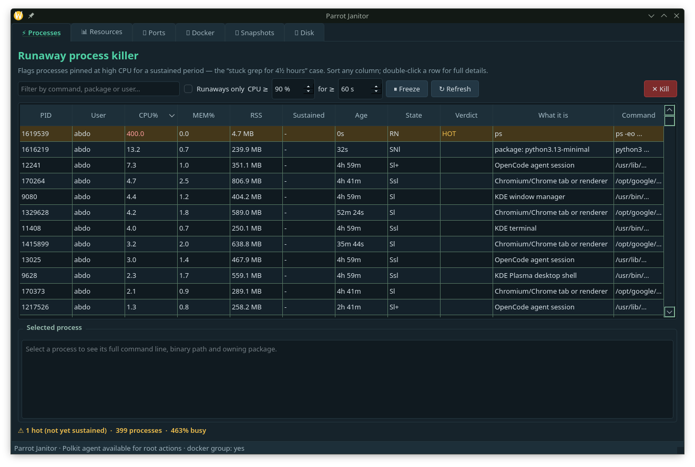

# Parrot Janitor

A Qt desktop GUI for Parrot OS covering six jobs that htop / KDE System
Monitor / bleachbit don't do **together**.



| Tab | What it does |
|---|---|
| ⚡ **Processes** | Live CPU/RAM table that flags *sustained* runaways — the "stuck `grep -oE '.{0,1500}…'"` pinned at 99% for 4½ hours case. Shows the binary path, owning Debian package and a plain-English description of what each process is. Sort any column, filter by command/package/user, one-click **Kill** with confirmation (SIGTERM, with an optional pkexec retry for root-owned processes). |
| 📊 **Resources** | Per-thread utilisation bars with heat colouring, a rolling 7-minute CPU/RAM history chart, load average, memory split into *in-use / reclaimable cache / free*, swap, and CPU/PCH/Wi-Fi/NVMe temperatures read from `/sys/class/thermal`. Red past 85 °C. |
| 🔌 **Ports & exposure** | Every listening socket from `ss`, classified by **scope** (loopback / LAN / multicast / all interfaces), then checked with a **real TLS handshake** or protocol banner — so "secured" means something, not a guess. Colour-coded `Secured` / `Local` / `Open` / `Exposed`, sorted so exposures sit at the top. Below it, a connect-test for 36 well-known ports gives an explicit **open / closed** answer. Plus a polkit-gated **Firewall status** view (`ufw` + `nft`). |
| 🐳 **Docker** | Lists all containers with live CPU/memory, multi-select, and bulk **start / stop / restart**, plus *Stop ALL running* behind a confirmation. You're already in the `docker` group, so no sudo here. |
| 📸 **Snapshots** | Create / inspect / delete read-only btrfs snapshots of `@` (root) and `@home` in `/.snapshots/`. Every action authenticates through **polkit** (`pkexec`) — never a bare `sudo`. |
| 💾 **Disk** | Measures Trash, `~/.cache`, pip cache, Desktop and home; finds the 60 biggest files under your home dir; empty trash / purge pip cache / delete a selected cache entry — each behind a confirmation. |

## Requirements

* Parrot Security (or any Debian/Ubuntu-ish distro)
* Python ≥ 3.9
* PySide6 — **already installed** on Parrot as `python3-pyside6.qtwidgets`
* `procps`, `docker`, `btrfs-progs`, `polkit` — all present on Parrot
* A running polkit authentication agent (Parrot/KDE ships `polkit-kde-authentication-agent-1`)

Nothing needs to be installed.

## Run

```bash
python3 parrotjanitor.py
```

Or just launch **Parrot Janitor** from your application menu after installing:

```bash
install -Dm755 parrotjanitor.py     ~/.local/bin/parrotjanitor.py
install -Dm644 parrot-janitor.svg   ~/.local/share/icons/hicolor/scalable/apps/parrot-janitor.svg
install -Dm644 parrot-janitor.desktop ~/.local/share/applications/parrot-janitor.desktop
update-desktop-database ~/.local/share/applications
```

## Self-test

```bash
python3 parrotjanitor.py --smoke
```

Runs headless: samples processes, queries docker, exercises the helper
functions and constructs every widget, then exits non-zero if anything is
broken. No window appears.

## Design notes

* **Runaway detection.** `RunawayTracker` keeps a `hot_since` timestamp per
  PID. A process becomes `HOT` the moment its CPU ≥ threshold (default 90%)
  and is promoted to `RUNAWAY` once it has stayed there for `sustain`
  seconds (default 60). Both knobs are spinboxes on the Processes tab.
* **Port verdicts are measured, not guessed.** For every TCP listener the app
  first tries a real `ssl` handshake, then falls back to a protocol banner
  read. `SSH-2.0-…` → secured. A successful handshake → secured with the TLS
  version recorded. Otherwise the scope decides: loopback is secured,
  multicast/link-local is *local segment only*, and anything else without TLS
  is `Open` — or `Exposed` if it is one of ~50 high-risk services (RDP,
  VNC, Telnet, SMB, Redis, the unauthenticated Docker API, Ollama, …).
  TLS handshake *timeouts* are treated as "no TLS", not as probe failures.
* **Graphs without QtCharts.** Only PySide6 Core/Gui/Widgets are packaged on
  Parrot, so `HistoryChart`, `CoreBars` and `MemBar` are painted directly
  with `QPainter`.
* **Never blocks the UI.** Every subprocess call goes through a `Task`
  (`QThread`) that emits a signal on completion. `sh()` imposes a timeout on
  everything, so no worker can hang forever. The port probe runs through a
  bounded `ThreadPoolExecutor` instead of the shell.
* **Polkit, not sudo.** Root operations shell out to `pkexec /bin/bash -c …`
  or `pkexec /usr/bin/btrfs …`, so you get the standard graphical password
  prompt from your desktop's polkit agent. The firewall view is read-only.
* **Destructive actions confirm first.** Kill, container stop, snapshot
  delete, empty trash and cache deletion all show a dialog listing exactly
  what will be affected before doing anything.
* **Clean shutdown.** Closing the window defers the close until background
  threads have drained instead of blocking on them — Qt aborts if a `QThread`
  is destroyed while running.

## Reversible deletions

The Disk tab's *Empty trash* is the only truly irreversible action in the
app, and it warns you about it. Everything else (kills, container stops,
snapshot deletes) is either recoverable or explicitly listed first.

## Files

```
ParrotJanitor/
├── parrotjanitor.py            the whole app (single file, ~3300 lines)
├── parrot-janitor.desktop      application-menu + desktop launcher
├── parrot-janitor.svg          app icon (128×128)
├── parrot-janitor-preview.png  screenshot (Processes tab)
├── LICENSE
└── README.md
```

Also installed system-wide by the `install` commands above (plus the Desktop
launcher at `~/Desktop/parrot-janitor.desktop`).

## What it found on this machine

The Ports tab flagged two genuine exposures immediately:

* **`*:3389` — RDP (`ms-wbt-server`)** listening on all interfaces with no TLS.
* **`*:11434` — Ollama** listening on all interfaces with **no authentication
  at all** by default, so anyone on the local network can drive your models.

SSH on `:22` was correctly identified as *Secured* straight from its
`SSH-2.0-OpenSSH_10.0p2 Debia…` banner, the loopback-only listeners (opencode,
gpsd on 2947) as secured by binding, and the 42 multicast mDNS sockets as
*Local* rather than counting them as open — so the summary reads
`147 listeners · 13 TCP · 4 loopback · 8 secured · 41 local · 97 open · 2 EXPOSED`
instead of crying wolf.

## License

[MIT](LICENSE) — © 2026 Abdellah ERRAOUI.
